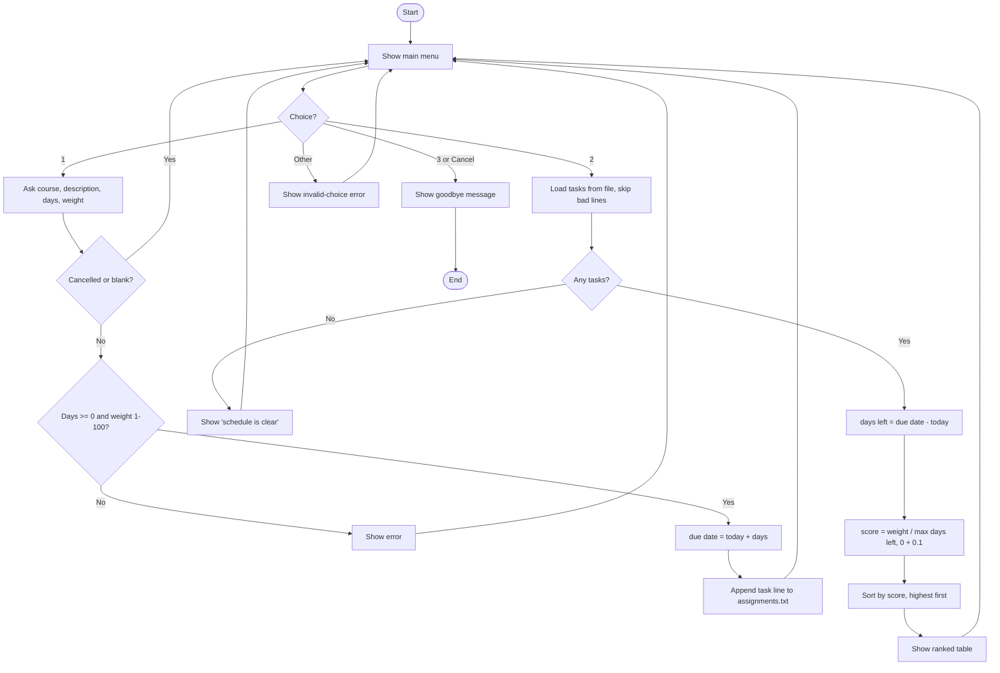

# Algorithm and Flowchart

## Main algorithm

1. Start the program and show the main menu in a dialog box.
2. Read the user's choice.
   - **1 – Add:** ask for course, description, days remaining, weightage.
     - If any prompt is cancelled or left blank, return to the menu.
     - If days < 0 or weightage is outside 1–100, show an error and return to the menu.
     - Otherwise compute `due date = today + days` and append `course|description|due date|weight` to `assignments.txt`.
   - **2 – View:** load every line of `assignments.txt`.
     - Skip (and count) any line that cannot be read.
     - If there are no tasks, show "schedule is clear".
     - For each task: `days left = due date − today`, then `score = weight / (max(days left, 0) + 0.1)`.
     - Sort tasks by score (highest first; earlier deadline breaks ties).
     - Display the ranked table.
   - **3 – Exit (or Cancel):** show a goodbye message and stop.
   - **Anything else:** show an error and ask again.
3. Repeat from step 1 until the user exits.

## Priority score

```
score = weight / (max(days_left, 0) + 0.1)
```

| Weight | Days left | Score |
|---|---|---|
| 5% | 0 | 50.00 |
| 15% | 2 | 7.14 |
| 20% | 5 | 3.92 |
| 10% | 9 | 1.10 |

## Flowchart



GitHub renders the diagram above automatically. For the report, you can export it as an image by pasting the code block into <https://mermaid.live>.
