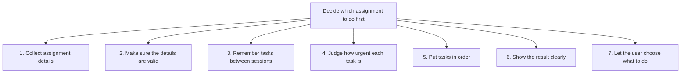
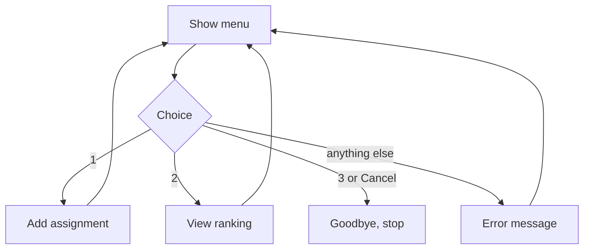
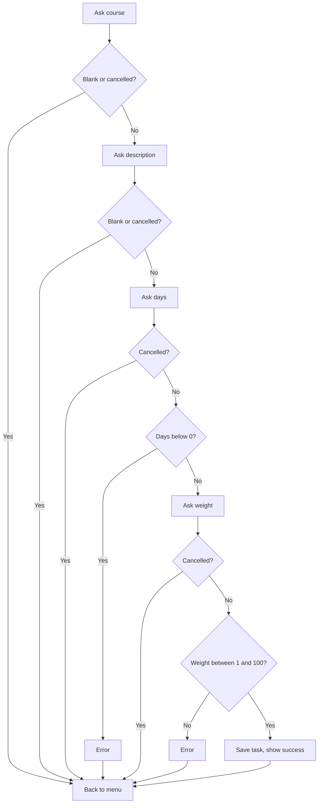
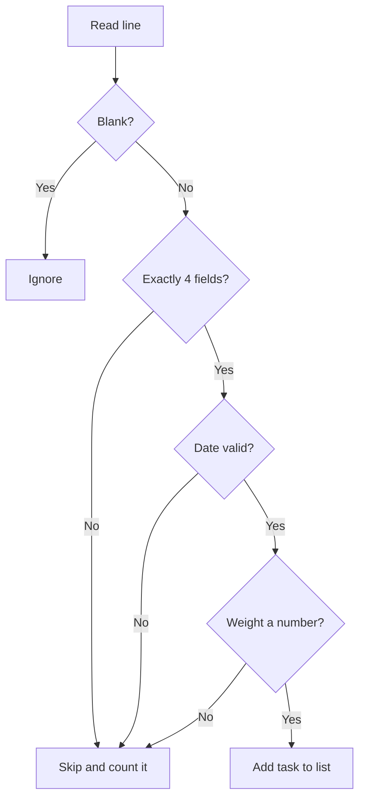
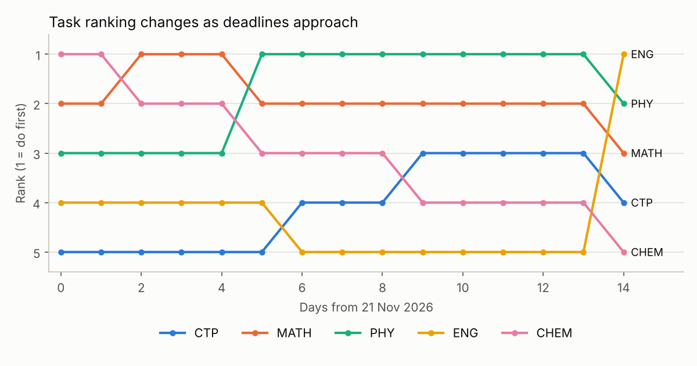
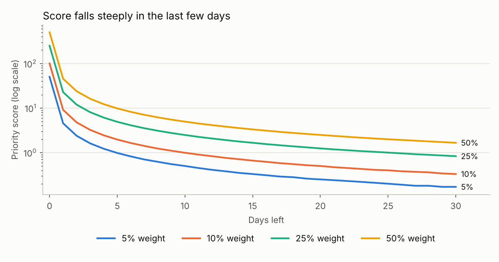

# Experiential Learning Activities 3–7 – EduPulse

These five sections go into the Milestone 2 report (one clearly labelled section each). Everything below is tied to the actual code in this repository. Numbers come from running the project's own functions (`analysis/data_interpretation.py`).

> **Team note – read before submitting.** Activities 3–6 are workshop-style activities (decomposition, card sorting, decision trees, paper-card modelling). This write-up gives you the finished result for EduPulse, but the rubric says each activity must actually be *performed*. Do a short session together, compare it with what is written here, correct anything your team would answer differently, and **attach photos of your cards/notes** if the LMS guidelines ask for evidence. Also check the detailed activity-wise rubric on the LMS ("Guidelines & Comprehensive Evaluation Rubric"), which I have not seen.

| Activity | Section | Also shown in |
|---|---|---|
| 3 – Problem Decomposition | [Activity 3](#activity-3--problem-decomposition-workshop) | Problem identification |
| 4 – Card Sorting | [Activity 4](#activity-4--card-sorting) | PPT, viva |
| 5 – Decision Tree Design | [Activity 5](#activity-5--decision-tree-design) | Demonstration |
| 6 – Object Modelling | [Activity 6](#activity-6--object-modelling-with-paper-cards) | PPT, viva |
| 7 – Data Interpretation | [Activity 7](#activity-7--data-interpretation-challenge) | Demonstration |

---

## Activity 3 – Problem Decomposition Workshop

**Real-world problem:** students cannot easily decide which assignment to do first when courses, deadlines and marks all differ.

**Breaking it down**



**Sub-problems mapped to modules and functions**

| # | Sub-problem | Python function | File |
|---|---|---|---|
| 1 | Collect course, description, days, weight | `add_task_ui` | `main.py` |
| 2a | Reject negative days | `validate_days` | `task_logic.py` |
| 2b | Reject weight outside 1–100 | `validate_weight` | `task_logic.py` |
| 2c | Keep free text from breaking the file | `clean_text` | `task_logic.py` |
| 3a | Save a task | `save_task` | `task_logic.py` |
| 3b | Load tasks, skip damaged lines | `load_tasks` | `task_logic.py` |
| 4a | Days from today to the due date | `days_until` | `task_logic.py` |
| 4b | Urgency score | `calculate_priority_score` | `task_logic.py` |
| 5 | Sort by score | `rank_tasks` | `task_logic.py` |
| 6a | Build the text table | `format_report` | `task_logic.py` |
| 6b | Show it in a window | `show_report`, `view_tasks_ui` | `main.py` |
| 7 | Menu loop | `run_menu` | `main.py` |

**Why this split works:** every function does one job and can be tested alone. Sub-problems 2–6 contain no GUI code, so they live in `task_logic.py` and are covered by automated tests. Only 1, 6b and 7 touch the screen.

---

## Activity 4 – Card Sorting

### Step 1 – Cards written

One card per piece of information, input, process or output in the project. Sorted into groups:

| Group | Cards |
|---|---|
| **User inputs** | course name, description, days remaining, weightage, menu choice |
| **Stored data** | course, description, due date, weight (one line per task in `assignments.txt`) |
| **Derived values** | days left, priority score, rank |
| **Processes** | validate, save, load, calculate score, sort, format table |
| **Outputs** | ranked table, "schedule is clear" message, error and success messages |
| **System modules** | interface layer (`main.py`), logic layer (`task_logic.py`), data file |

**Sorting decision:** the cards "days left", "score" and "rank" were *not* put under "stored data". Values that change with time or can be recomputed are derived on demand; only the due date is stored. This one sorting decision removed the stale-days problem (a stored "days remaining" never changes after it is typed).

### Step 2 – Alternative algorithms compared

Same five sample tasks, three ways of ranking (output of `analysis/data_interpretation.py`, today = 21 Nov 2026):

| Rank | Deadline only | Weight only | **Weight / (days + 0.1)** |
|---|---|---|---|
| 1 | CHEM | ENG | **CHEM** |
| 2 | MATH | PHY | **MATH** |
| 3 | PHY | MATH | **PHY** |
| 4 | CTP | CTP | **ENG** |
| 5 | ENG | CHEM | **CTP** |

| Approach | Strength | Weakness (seen in the table) |
|---|---|---|
| Deadline only | Simple | Puts ENG (25%, the most valuable task) last |
| Weight only | Simple | Puts CHEM, which is **due today**, last |
| **Weight / (days + 0.1)** | Balances value and urgency | Urgency can dominate (see Activity 7) |

**Decision:** the ratio formula. It is the only approach that gets both CHEM (due today) at the top and ENG ahead of CTP (higher weight, further away).

### Step 3 – Other architectural choices

| Decision | Chosen | Alternative | Reason |
|---|---|---|---|
| Storage | Text file, one line per task | Keep list in memory only | Tasks must survive closing the program |
| Date stored | Due date | Days remaining | Days left stay correct over time |
| Interface | tkinter dialogs | Console `input()` | Friendlier, no console needed |
| Code layout | Logic and GUI in separate files | One file | Logic can be tested without a window |

---

## Activity 5 – Decision Tree Design

### Tree A – Main menu (`run_menu`)



### Tree B – Adding an assignment (`add_task_ui`) – nested conditions



### Tree C – Reading one line of the data file (`load_tasks`)



### Tree D – Showing days left (`format_report`) and urgency (`calculate_priority_score`)

```
if days left < 0:   show "OVERDUE", score uses 0 days   (treated as due today)
else:               show the number, score uses days left
```

### Where each branch is demonstrated (automated tests)

| Branch | Test that proves it |
|---|---|
| Blank course → back to menu | `test_blank_course_cancels` |
| Cancel on days → quiet return | `test_cancel_on_days_is_silent` |
| Negative days → error | `test_negative_days_rejected` |
| Weight outside 1–100 → error | `test_weight_out_of_range_rejected` |
| Valid input → saved | `test_valid_task_is_saved` |
| Invalid menu choice → error | `test_menu_flow` |
| No tasks → "schedule is clear" | `test_view_empty_shows_clear_message` |
| Damaged lines skipped | `test_bad_lines_are_skipped_not_fatal` |
| Overdue treated as due today | `test_overdue_treated_as_due_today` |

For the live demo, walk through Tree B using real dialog windows: one error case, one cancel, one success.

---

## Activity 6 – Object Modelling with Paper Cards

### Entities, attributes and behaviours (the model)

| Object | Attributes | Behaviours |
|---|---|---|
| **Task** | course, description, due date, weight, days left, score | compute days left, compute score, convert to/from a stored line |
| **TaskStore** (the data file) | file path | save a task, load all tasks, skip damaged lines |
| **Ranker** | – | score every task, sort descending |
| **Report view** | – | format the table, display it |
| **App / menu** | – | show menu, route the choice |

### How the model appears in the current code

The project is written with **functions and dictionaries**, not classes. The model above is how those pieces map:

| Object in the model | In the code today |
|---|---|
| Task | a dictionary with keys `course`, `desc`, `due`, `days`, `weight`, `score` |
| Task behaviours | `days_until`, `calculate_priority_score` |
| TaskStore | `save_task`, `load_tasks`, `DATA_FILE` |
| Ranker | `rank_tasks` |
| Report view | `format_report`, `show_report` |
| App / menu | `run_menu`, `add_task_ui`, `view_tasks_ui` |

### Relationships

- **Encapsulation (as practised in the code):** the interface (`main.py`) never knows the file format. Only `task_logic.py` knows the `course|description|due|weight` layout, so the format could change without touching the GUI. This is exactly what happened when `days remaining` became `due date`.
- **Composition / use:** the App uses the TaskStore to get Tasks, the Ranker to order them, and the Report view to show them.
- **Inheritance:** there is **no inheritance** in this project. The honest answer in the viva is that the problem has one kind of task, so a class hierarchy would be artificial.

> **Decision needed from the team.** If your LMS guideline expects classes in the *implementation* (not only on paper), say so and the code can be refactored so `Task` and `TaskStore` are real classes with methods. I have not done that, since you asked for no unnecessary rewrites. If you keep the function-based design, be ready to explain this mapping table.

---

## Activity 7 – Data Interpretation Challenge

Dataset: five sample tasks (see `docs/SAMPLE_IO.md`), analysed with `python analysis/data_interpretation.py`.

### Table 1 – Summary (today = 21 Nov 2026)

| Measure | Value |
|---|---|
| Number of tasks | 5 |
| Total weightage | 75% |
| Average days left | 6 |
| Highest score | 50.0 (CHEM) |
| Lowest score | 1.1 (CTP) |
| Average score | 12.79 |
| Median score | 3.92 |
| Tasks due within 3 days | 2 |

### Table 2 – Rank of each task as days pass (1 = do first)

| Course | +0d | +2d | +4d | +6d | +8d | +10d | +12d | +14d |
|---|---|---|---|---|---|---|---|---|
| CTP | 5 | 5 | 5 | 4 | 4 | 3 | 3 | 4 |
| MATH | 2 | 1 | 1 | 2 | 2 | 2 | 2 | 3 |
| PHY | 3 | 3 | 3 | 1 | 1 | 1 | 1 | 2 |
| ENG | 4 | 4 | 4 | 5 | 5 | 5 | 5 | 1 |
| CHEM | 1 | 2 | 2 | 3 | 3 | 4 | 4 | 5 |



### Table 3 – Priority score for different weights and days left

| Weight \ Days left | 0 | 1 | 3 | 7 | 14 | 30 |
|---|---|---|---|---|---|---|
| 5% | 50.0 | 4.55 | 1.61 | 0.7 | 0.35 | 0.17 |
| 10% | 100.0 | 9.09 | 3.23 | 1.41 | 0.71 | 0.33 |
| 25% | 250.0 | 22.73 | 8.06 | 3.52 | 1.77 | 0.83 |
| 50% | 500.0 | 45.45 | 16.13 | 7.04 | 3.55 | 1.66 |
| 100% | 1000.0 | 90.91 | 32.26 | 14.08 | 7.09 | 3.32 |



### Key insights

1. **Urgency changes the order quickly.** The top task changes from CHEM (days 0–1) to MATH (days 2–4) to PHY (days 5–13) as each deadline arrives. A ranking made on day 0 is out of date within two days, which is why the program stores due dates and recalculates.
2. **The score drops by about 91% in the first day.** For every weight in Table 3, going from 0 days to 1 day left cuts the score from `weight/0.1` to roughly `weight/1.1` (for example 50.0 → 4.55 for a 5% task). After that the curve flattens: scores change slowly between 14 and 30 days left, so the ranking is driven mostly by tasks in their last week.
3. **The average hides the pattern.** The mean score (12.79) is more than three times the median (3.92) because one task due today (CHEM, 50.0) pulls the mean up. The median describes a typical task better.
4. **Overdue tasks are treated as due today.** At +14 days, four of the five tasks are overdue, and they are ordered by weight alone (PHY 20% and MATH 15% above CTP 10% and CHEM 5%). ENG, with the highest weight (25%) and due exactly that day, is first. This is the intended behaviour: nothing overdue sinks to the bottom.
5. **Limitation found in the data.** A 1% task due today scores 10.0, which beats a 100% task due in 10 days (9.9). Urgency can outweigh importance. This is a known trade-off of the `weight / (days + 0.1)` formula and a good point for "future improvements" (for example capping the urgency term). It has not been changed because it does not affect normal use with realistic weights.
